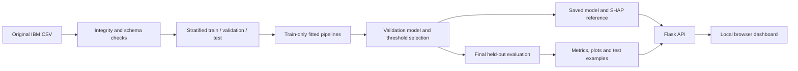

# Telecom Customer Churn Prediction with Explainability

A local college project that scores telecom customer accounts, explains individual predictions with SHAP, and reports reproducible held-out evaluation. The Flask dashboard supports customer search, an editable prediction form, CSV scoring and a model lab. It uses IBM's sample dataset and requires no cloud account or paid API.

The full website has a product home, overview, customer analysis, batch scoring, model lab and an in-site guide. Each has a refreshable URL. The current branded UI draws on [related-product research](docs/UI_RESEARCH_V3.md), with a larger hero, actual-data product preview, workflows, FAQs and consistent analyst pages.

The output estimates the sample's historical churn label. It is not a proven next-month forecast or evidence that a retention suggestion will work.

## Run on Windows

Prerequisite: install [uv](https://docs.astral.sh/uv/getting-started/installation/). Run these commands in PowerShell:

```powershell
Set-Location -LiteralPath 'D:\koding\Telecom Customer Churn Prediction with Explainability'
uv sync --frozen --python 3.12
uv run python scripts/train.py
uv run python app.py --host 127.0.0.1 --port 5050
```

Open **http://127.0.0.1:5050**. Training downloads and integrity-checks the canonical dataset if needed, then generates the model and evaluation artifacts. Internet access is needed for the first dependency/data download. Existing verified data and installed dependencies support later local runs.

Use **Open workspace** on the home page or visit `/overview` directly. Individual pages are `/analysis`, `/batch`, `/models` and `/guide`.

After setup and training, `uv run python app.py` is sufficient to start the app. The project also includes `start.ps1` as a Windows launcher. If the model is unavailable, train it before expecting predictions; the app must not invent fallback scores.

On Windows, `npm run dev` calls the same `start.ps1` launcher. It adds no JavaScript dependencies and does not require `npm install`.

## Deploy on Vercel

Run `npm run build` first. This executes real model/SHAP/CSV smoke checks and copies website assets to `public/static/`; it does not retrain or alter the model results. Python and uv must be installed locally.

Push the complete project, including `artifacts/model.joblib`, to Git. Import the repository in Vercel, set the root to this project directory, choose the **Flask** preset, and leave the output directory and install command at their defaults. The checked-in `vercel.json` supplies `python scripts/build.py` as the build command; `.python-version` selects Python 3.12. No API keys or database are needed. Do not choose a static/Vite/Next.js preset.

The Python function performs real inference and SHAP explanations using the frozen model. Training-only XGBoost/matplotlib dependencies stay out of the hosted runtime. After deployment, check `/api/health` reports `ready`, then test prediction and upload the downloadable sample CSV. See [deployment details and verification limits](docs/DEPLOYMENT.md).

## What to try

The overview's interactive chart compares observed churn and mean model probability across actual held-out tenure groups. Contract controls change the population. These are tenure cohorts, not invented calendar history or a prospective forecast; the accessible data table exposes counts and rates.

1. **Overview:** inspect real dataset summaries and search/filter the held-out customer queue.
2. **Customer analysis:** load a real test customer, inspect its score and signed SHAP factors, then edit fields to explore a clearly labelled manual scenario.
3. **Batch scoring:** download the actual sample CSV, upload it, and download probabilities and threshold-based decisions. Input files must contain the predictor columns and may include `customerID`. The raw training CSV includes additional fields and is not the batch-input template.
4. **Model lab:** compare validation/test results, confusion matrix, curves, calibration diagnostics and run provenance. The winner is selected using validation, not the displayed test ranking.

CSV scoring is limited to 1,000 rows and 2 MiB. Invalid headers, values or service combinations return an error rather than silently producing partial scores. Uploaded files are processed in memory and not saved as customer history.

## Reproduce and check

| Command | Purpose |
|---|---|
| `uv sync --frozen --python 3.12` | Install the locked environment |
| `uv run python scripts/download_data.py` | Fetch/check only the canonical source data |
| `uv run python scripts/train.py` | Rebuild training and evaluation artifacts |
| `uv run python scripts/eda.py` | Generate source-quality checks and training-only EDA report/figures |
| `uv run pytest` | Run the project's tests after training |
| `uv run ruff check .` | Check Python code |
| `uv run python app.py --port 5050` | Serve the local application |

The actual verification record is in [docs/VERIFICATION.md](docs/VERIFICATION.md). Re-running training replaces generated artifacts; restart the application to load the new model. Do not replace the model with a downloaded `joblib`/pickle file: deserialisation trusts local model files.

For browser regression checks, install the test browser once, keep the app running in another terminal, then run:

```powershell
uv run python -m playwright install chromium
uv run python scripts/browser_check.py --url http://127.0.0.1:5050
```

The browser script exercises real predictions and downloads, delayed-response transitions, responsive views and keyboard navigation. Screenshots and its JSON result are saved under `artifacts/browser/`.

The source hash and download provenance live in `data/provenance.json`. `artifacts/summary.json` contains the executed experiment's metrics, model choice and metadata; `artifacts/splits.json` records partition membership; `artifacts/customers.json` contains held-out examples; `artifacts/plots/` holds generated evaluation plots. Generated results are evidence from this run, not promised results for another dataset.

## Call the API with a real example

With the server running, this PowerShell example retrieves an actual held-out row and predicts from its recorded features:

```powershell
$baseUrl = 'http://127.0.0.1:5050'
Invoke-RestMethod "$baseUrl/api/health"
$customer = (Invoke-RestMethod "$baseUrl/api/customers?page_size=1").items[0]
$body = $customer.features | ConvertTo-Json -Depth 5
Invoke-RestMethod "$baseUrl/api/predict" -Method Post -ContentType 'application/json' -Body $body
```

`GET /api/schema` returns the exact input fields and allowed values. `GET /api/sample.csv` downloads real held-out rows suitable for the batch endpoint. See [docs/API_CONTRACT.md](docs/API_CONTRACT.md) for the complete request/response contract and error handling. No invented customer record or assumed model score is needed for this example.

## How it works



The candidate models are a dummy baseline, logistic regression, random forest and XGBoost. Validation average precision selects the predictive model; validation F1 selects the operating threshold. The selected train-fitted model is preserved. SHAP explanations group encoded contributions into original fields and verify that they reconstruct the explained output.

| Location | Responsibility |
|---|---|
| `src/churn/schema.py` | Shared predictor definitions and validation |
| `src/churn/` | Training and model inference/explanation logic |
| `scripts/download_data.py`, `scripts/train.py` | Reproducible data retrieval and training entry points |
| `app.py` | Local Flask routes, CSV handling and artifact serving |
| `templates/`, `static/` | Responsive browser interface |
| `tests/` | Model, validation and API checks |
| `docs/` | Research, assumptions, methodology and viva material |

## Read for the college submission

- [Eight-point project status](docs/PROJECT_STATUS.md): current stage, requirement audit, challenges and next steps.
- [EDA report](docs/EDA_REPORT.md): executed training-only distributions, associations, quality checks and figures.
- [Project report](docs/PROJECT_REPORT.md): problem, architecture, implemented scope and actual results.
- [Viva guide](docs/VIVA_GUIDE.md): a demo script and questions with explainable answers.
- [Methodology](docs/METHODOLOGY.md), [model card](docs/MODEL_CARD.md), [data card](docs/DATA_CARD.md).
- [ML/GitHub research](docs/RESEARCH_ML.md), [UI references](docs/RESEARCH_UI.md), [assumptions](docs/ASSUMPTIONS.md).
- [API contract](docs/API_CONTRACT.md), [verification record](docs/VERIFICATION.md).

## Attribution and limits

For current references and screenshots, see [UI research revision 3](docs/UI_RESEARCH_V3.md). The [previous dashboard research](docs/UI_REFERENCE_RESEARCH_V2.md) remains historical. [Deployment instructions](docs/DEPLOYMENT.md) cover `serve.py`, HOST/PORT, Docker and later hosting. No cloud publication is required for localhost use.

[UI match evidence](docs/UI_MATCH.md) links the actual side-by-side reference comparison. Run `uv run python scripts/reference_check.py` while the server is running to regenerate the capture and measured checks.

Data: [IBM/telco-customer-churn-on-icp4d](https://github.com/IBM/telco-customer-churn-on-icp4d), whose source repository supplies an [Apache-2.0 license](https://github.com/IBM/telco-customer-churn-on-icp4d/blob/master/LICENSE). The comparison research is documented separately; this app does not claim to reproduce competing repositories' scores.

This fictional-company benchmark does not establish future-period, Indian-operator or production performance. Removing demographic predictors does not prove fairness. SHAP explains model associations, not causal effects. No campaign uplift, savings or guaranteed retention is claimed. Local serving defaults to loopback. Vercel configuration supports a public benchmark demo; private customer accounts, authentication and production monitoring are outside this demo.
