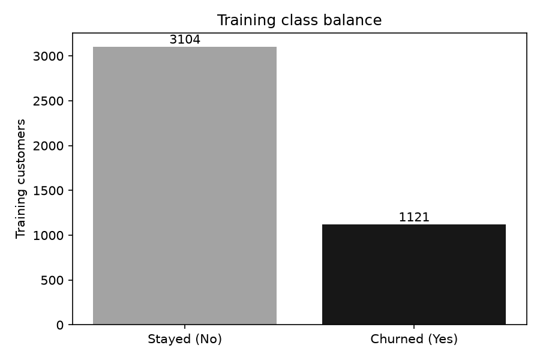
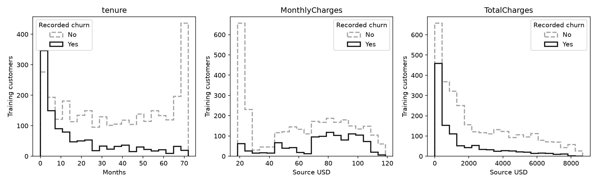
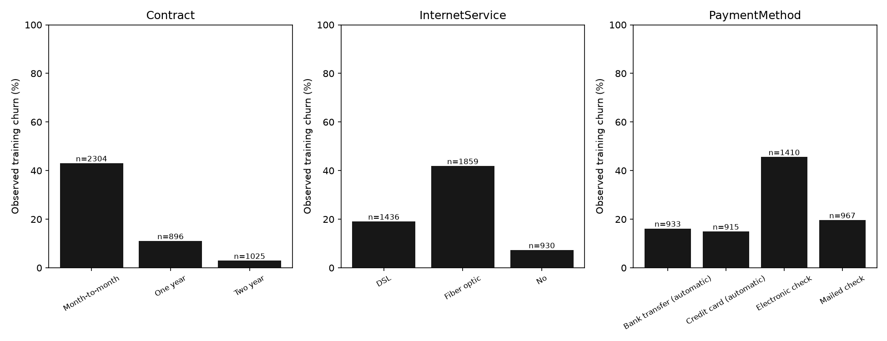
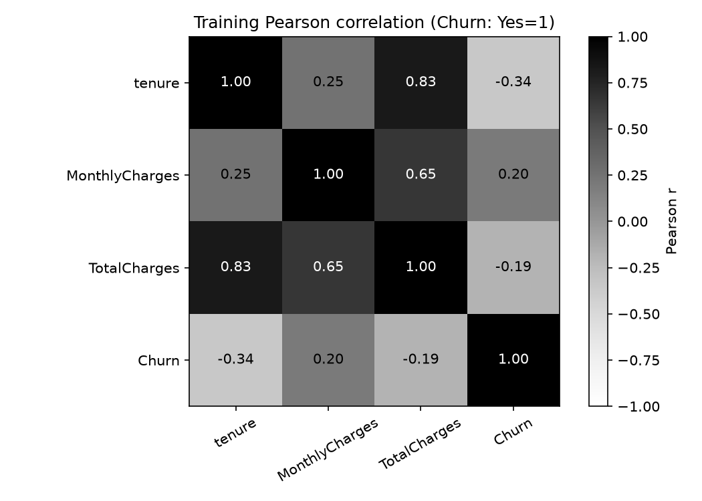

# Exploratory Data Analysis (EDA)

Generated at 2026-11-18T18:21:09.628596+00:00. Reproduce with `uv run python scripts/eda.py`.

## Scope and timing

This report was added after the original model was frozen. It is descriptive follow-up, not evidence that these plots guided the original model choice. Source-quality checks use the full CSV; all plotted distributions and feature/target relationships use the saved training partition only. No fitting, model selection, threshold change or held-out-label EDA is performed.

Source SHA-256: `16320c9c1ec72448db59aa0a26a0b95401046bef5d02fd3aeb906448e3055e91`. Saved split SHA-256: `b81a63e7985c82f122aa5a97f2c348427ec2b06cd396babdf3644a6b132e8ced`.

## Data quality and preprocessing

| Check | Executed result |
|---|---:|
| Source rows | 7,043 |
| Source columns | 21 |
| Unique customer IDs | 7,043 |
| Exact duplicate rows | 0 |
| Repeated profiles excluding customer ID | 22 |
| Blank zero-tenure TotalCharges filled with zero | 11 |
| Missing values after cleaning | 0 |
| Rows dropped | 0 |

Repeated profiles can belong to distinct customers and are not automatically removed. Only the documented zero-tenure blank-charge rule fills values; schema checks reject unexplained invalid values. Raw/cleaned types and per-column missing counts are recorded in `artifacts/eda/summary.json`.

## Training class balance

Training population: 4,225. No: 3,104; Yes: 1,121. Observed churn: 26.53%. The unequal class counts motivate reporting precision, recall and average precision alongside accuracy.

## Numerical distributions and outlier diagnostics

| Field | Mean | Median | Min | Max | Outside 1.5-IQR fences |
|---|---:|---:|---:|---:|---:|
| tenure | 32.443 | 29.000 | 0.000 | 72.000 | 0 |
| MonthlyCharges | 64.895 | 70.550 | 18.400 | 118.750 | 0 |
| TotalCharges | 2295.489 | 1372.450 | 0.000 | 8684.800 | 0 |

IQR fences are descriptive diagnostics, not automatic deletion rules. All validated source rows remain in the experiment. Histograms use identical bins for both labels; their vertical axes are counts, not within-class densities.

## Categorical associations

The tables below cover every categorical predictor. Rates are descriptive training associations, not causal effects or prospective forecasts. Compare group counts as well as rates.

### Observed training findings

Month-to-month accounts have observed churn 43.06% (n=2,304), compared with 2.93% for two-year accounts (n=1,025). These groups may differ in other attributes; this is not evidence that changing a contract causes retention.

Training Pearson r between tenure and the binary churn indicator is -0.345; between monthly charges and churn it is 0.198. These are measured linear associations, not model performance or causal effects.

### Partner

| Category | Customers | Churned | Observed churn |
|---|---:|---:|---:|
| No | 2,190 | 722 | 32.97% |
| Yes | 2,035 | 399 | 19.61% |

### Dependents

| Category | Customers | Churned | Observed churn |
|---|---:|---:|---:|
| No | 2,965 | 935 | 31.53% |
| Yes | 1,260 | 186 | 14.76% |

### PhoneService

| Category | Customers | Churned | Observed churn |
|---|---:|---:|---:|
| No | 414 | 97 | 23.43% |
| Yes | 3,811 | 1,024 | 26.87% |

### MultipleLines

| Category | Customers | Churned | Observed churn |
|---|---:|---:|---:|
| No | 2,026 | 510 | 25.17% |
| No phone service | 414 | 97 | 23.43% |
| Yes | 1,785 | 514 | 28.80% |

### InternetService

| Category | Customers | Churned | Observed churn |
|---|---:|---:|---:|
| DSL | 1,436 | 274 | 19.08% |
| Fiber optic | 1,859 | 779 | 41.90% |
| No | 930 | 68 | 7.31% |

### OnlineSecurity

| Category | Customers | Churned | Observed churn |
|---|---:|---:|---:|
| No | 2,073 | 873 | 42.11% |
| No internet service | 930 | 68 | 7.31% |
| Yes | 1,222 | 180 | 14.73% |

### OnlineBackup

| Category | Customers | Churned | Observed churn |
|---|---:|---:|---:|
| No | 1,822 | 736 | 40.40% |
| No internet service | 930 | 68 | 7.31% |
| Yes | 1,473 | 317 | 21.52% |

### DeviceProtection

| Category | Customers | Churned | Observed churn |
|---|---:|---:|---:|
| No | 1,820 | 708 | 38.90% |
| No internet service | 930 | 68 | 7.31% |
| Yes | 1,475 | 345 | 23.39% |

### TechSupport

| Category | Customers | Churned | Observed churn |
|---|---:|---:|---:|
| No | 2,040 | 865 | 42.40% |
| No internet service | 930 | 68 | 7.31% |
| Yes | 1,255 | 188 | 14.98% |

### StreamingTV

| Category | Customers | Churned | Observed churn |
|---|---:|---:|---:|
| No | 1,622 | 548 | 33.79% |
| No internet service | 930 | 68 | 7.31% |
| Yes | 1,673 | 505 | 30.19% |

### StreamingMovies

| Category | Customers | Churned | Observed churn |
|---|---:|---:|---:|
| No | 1,645 | 557 | 33.86% |
| No internet service | 930 | 68 | 7.31% |
| Yes | 1,650 | 496 | 30.06% |

### Contract

| Category | Customers | Churned | Observed churn |
|---|---:|---:|---:|
| Month-to-month | 2,304 | 992 | 43.06% |
| One year | 896 | 99 | 11.05% |
| Two year | 1,025 | 30 | 2.93% |

### PaperlessBilling

| Category | Customers | Churned | Observed churn |
|---|---:|---:|---:|
| No | 1,754 | 279 | 15.91% |
| Yes | 2,471 | 842 | 34.08% |

### PaymentMethod

| Category | Customers | Churned | Observed churn |
|---|---:|---:|---:|
| Bank transfer (automatic) | 933 | 151 | 16.18% |
| Credit card (automatic) | 915 | 137 | 14.97% |
| Electronic check | 1,410 | 643 | 45.60% |
| Mailed check | 967 | 190 | 19.65% |

## Correlation

Pearson correlation describes linear relationships among the three numeric predictors and a binary churn indicator (Yes=1). It does not capture every nonlinear or categorical relationship. Total charges and tenure may encode overlapping account history; correlation alone does not justify dropping a predictor or establish leakage. The complete numeric matrix is in the JSON evidence.

## Limits and next steps

This fictional-company sample supplies no external operator cohort or dated future outcomes. Group association, a model coefficient and SHAP are different quantities; none demonstrates a retention intervention's effectiveness. Keep the frozen evaluation and pursue representative temporal/external validation and subgroup error analysis before operational use.
