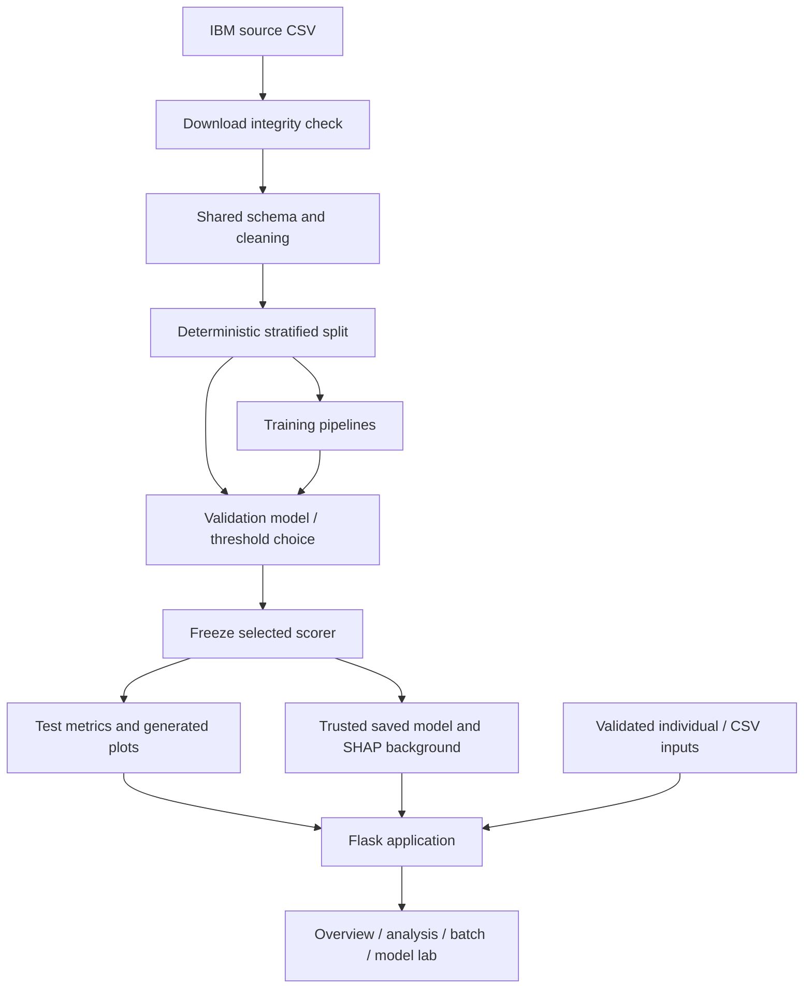
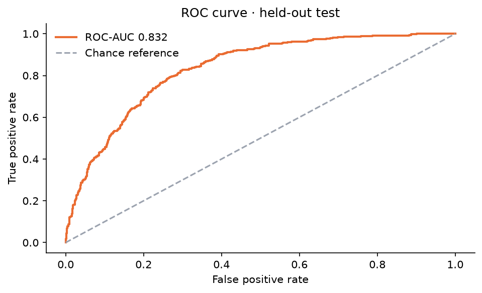
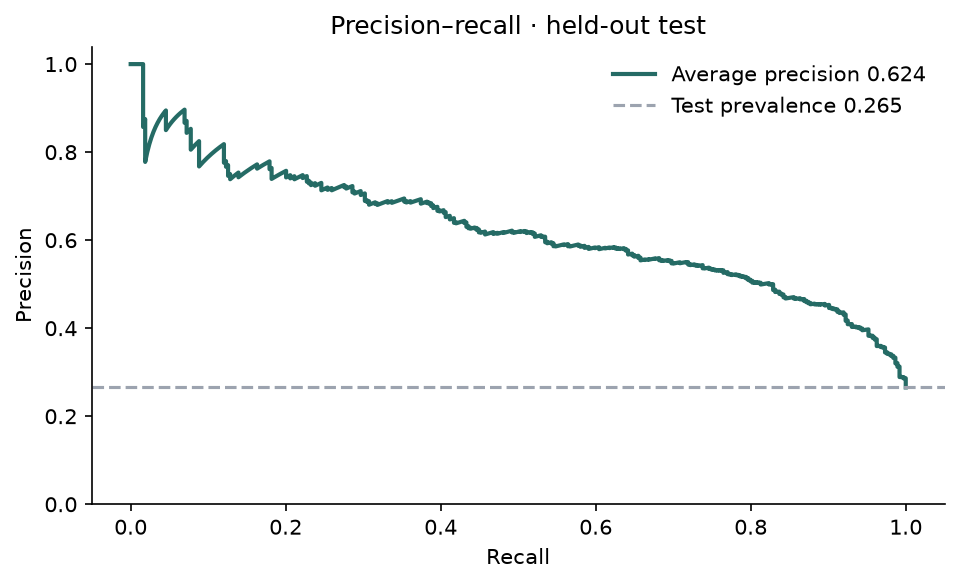
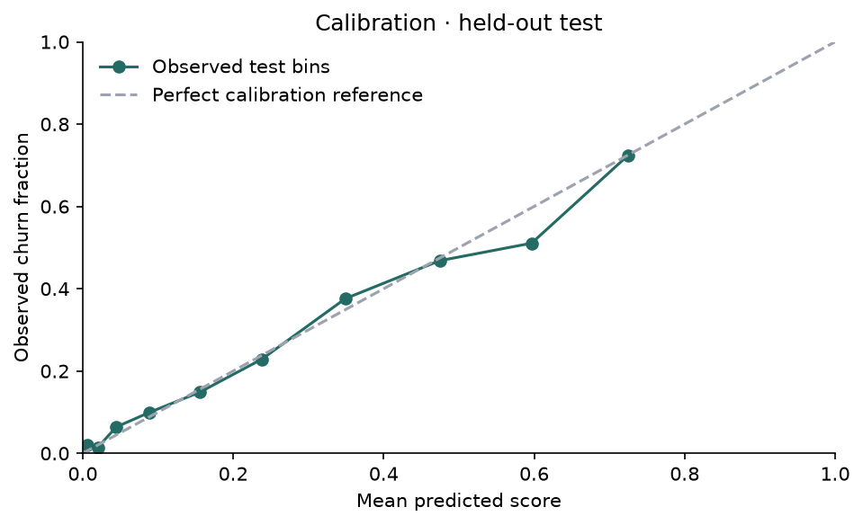
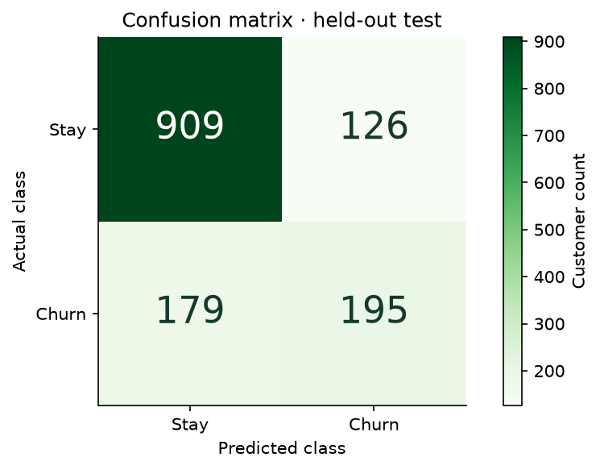

# Telecom Customer Churn Prediction with Explainability

## Abstract

This project implements a local decision-support application for analysing customer churn in IBM's Telco sample. It combines a reproducible machine-learning experiment with an interface for individual predictions, SHAP explanations, customer search and CSV scoring. A separate validation partition selects the model and threshold; a held-out test partition supplies final evaluation. The project focuses on understandable code, traceable results and explicit limitations rather than an unsupported accuracy target. Its explanations describe the fitted model and do not establish causal reasons for departure or guaranteed retention benefits.

## Problem and motivation

Telecom teams may want to identify accounts associated with churn and understand which recorded attributes influenced a model's score. A bare binary classification is insufficient: an analyst needs the probability estimate, the decision rule, a feature-level explanation and evidence about model errors.

The educational problem is therefore to build the full path from a documented source file to a checked prediction interface. The dataset is a fictional-company benchmark, so the project demonstrates a method rather than a proven operating system for a real telecom company.

## Objectives and scope

- Validate the canonical input and preserve source provenance.
- Compare an interpretable linear classifier, tree-based alternatives and a non-learning baseline under the same split.
- Select the model and threshold without consulting test results.
- Generate final metrics and plots from executed predictions.
- Explain customer scores with genuine additive attributions and explicit units.
- Provide a responsive local dashboard, complete customer input validation and bounded CSV export.
- Document reproducibility, assumptions and limitations for a viva.

Production campaigns, paid APIs, generative explanations, multi-user authentication, cloud deployment and a database are outside scope. They are not needed for a self-contained single-user demonstration.

## Research and design choices

The [research comparison](RESEARCH_ML.md) distinguishes inspected source code from README-only references. IBM is the primary data source. The inspected projects informed the separation of training and inference, validation-based selection, customer-level explanations and batch workflow. Their reported metrics are not adopted as this project's results.

Important rejected patterns include hard-coded dashboard scores, manual reconstruction of training encodings in the app, using the current customer as its own SHAP background, and changing the scorer after choosing its threshold. The [UI research](RESEARCH_UI.md) records the visual references and interaction decisions. This project implements its own small application rather than copying a repository wholesale.

Flask and plain browser JavaScript keep the code accessible: the student can trace a form submission through an API route, shared schema, fitted pipeline and explanation without a second frontend framework. SQLite or MySQL would add persistence without serving the chosen stateless demo workflow.

## System architecture

The offline training path owns fitting and evaluation. The serving path loads the frozen artifacts and never learns from uploaded customers. Their only shared responsibility is interpreting the same input schema.

## Data and experimental method

The [data card](DATA_CARD.md) describes the original CSV, field meanings and source license. Identifier and target are excluded from predictors. Gender and senior-citizen status are also excluded, without claiming that this makes the system fair.

Blank total charges are handled only for source-supported zero-tenure records. Categorical features are encoded within fitted pipelines. Customer IDs are saved separately to audit partition overlap.

The experiment uses approximately 60% training, 20% validation and 20% test rows. Dummy, logistic regression, random forest and XGBoost candidates share those partitions. Validation average precision selects the predictive model; validation F1 selects a classification threshold. The train-fitted winner remains unchanged. Final metrics include accuracy, precision, recall, F1, ROC-AUC, average precision, Brier score and a confusion matrix. Full details and interpretation are in [METHODOLOGY.md](METHODOLOGY.md).

## Explanation method

A SHAP explanation comprises a reference output and signed contributions. Contributions from encoded columns are summed back to original customer fields. The application checks their reconstruction against the actual model output and labels probability or log-odds units.

A positive attribution increases that model's explained output for the selected row relative to its reference. It does not prove that a recorded feature caused churn. Similarly, recomputing a score after editing contract type is a model scenario, not an experiment showing that a new contract would retain that customer.

## Implemented application

The website includes a product home and guide, refreshable `/overview`, `/analysis`, `/batch` and `/models` URLs, and a related-product reference-led interface. The current design uses the user's requested black accent and neutral surfaces; [current UI evidence](UI_MATCH.md) supersedes the historical shadcn measurements. The overview's contract-filtered tenure chart aggregates genuine held-out records. It does not invent a calendar churn history.

A portable Waitress entry point and Docker packaging support later deployment. An earlier Linux image was tested; the latest UI image rebuild remains unverified because of registry/engine availability. The Dockerfile regenerates native model artifacts during its build and specifies a non-root user. No public hosting is claimed; see [DEPLOYMENT.md](DEPLOYMENT.md).

| Component | Purpose |
|---|---|
| Overview | Source-derived descriptive statistics, contract segments and held-out customer queue |
| Customer analysis | A complete editable input form, probability, decision threshold and signed local explanation |
| Batch scoring | Validated in-memory CSV input and downloadable scores without an upload database |
| Model lab | Actual comparison metrics, evaluation plots, source/run provenance and limitations |
| Shared schema | Consistent columns, allowed categories, numerical bounds and service dependencies |
| Artifact checks | Verify locally generated files before loading the trusted model |

The API rejects invalid or contradictory inputs. Batch validation finishes before scoring, so a bad row does not quietly produce a partial output. Downloaded identifiers are protected against spreadsheet formula execution. Missing models return an unavailable state rather than substitute probabilities.

## Results and verification

The [eight-point status update](PROJECT_STATUS.md) maps the college reporting requirements to current evidence. The [standalone EDA report](EDA_REPORT.md), added after the original model was frozen, now records source quality and training-only class balance, numeric distributions, categorical associations, IQR diagnostics and correlations. Reproduce it with `uv run python scripts/eda.py`; it does not retune the model or explore held-out labels.

The executed run uses `7,043` sample customers, with `4,225` training, `1,409` validation and `1,409` test rows. Logistic regression was selected by validation average precision (`0.676589`), narrowly ahead of random forest (`0.676530`) and XGBoost (`0.676298`). This near tie is not evidence of meaningful universal superiority.

At the validation-selected threshold `0.49934350911717607`, the selected model's test results are:

| Accuracy | Precision | Recall | F1 | ROC-AUC | Average precision | Brier score |
|---:|---:|---:|---:|---:|---:|---:|
| 0.783534 | 0.607477 | 0.521390 | 0.561151 | 0.832473 | 0.624212 | 0.141488 |

Its confusion matrix contains `909` true negatives, `126` false positives, `179` false negatives and `195` true positives. The missed churn-labelled customers are a practical limitation despite the aggregate accuracy. Random forest has a better test F1 and average precision in this run, but switching models using that knowledge would compromise the declared test protocol.

The [model card](MODEL_CARD.md) contains the full comparison, fixed-model bootstrap intervals, run timestamps and explanation checks. Full precision remains in `artifacts/summary.json`. The following plots are generated from that executed run, not illustrations or copied figures.

The verification record is [VERIFICATION.md](VERIFICATION.md). It is the authority for commands actually executed, observed pass/fail outcomes, browser checks and remaining limitations. Planned checks in design documents must not be described as completed evidence.

## Limitations and future work

The sample does not establish a prospective time horizon, external operator transfer or current real-world performance. A single holdout is sensitive to the chosen split. Probability calibration, subgroup error disparities and correlated-feature attribution deserve further evaluation. A real deployment would also require representative timestamped data, access controls, secure operational hosting and drift monitoring.

Retention effectiveness would require a campaign experiment or suitable causal/uplift study with recorded outcomes and costs. Neither SHAP nor a feature edit supplies that evidence. No measured financial benefit is claimed here.

## Submission and demonstration material

The [README](../README.md) contains Windows setup and reproduction commands. The [viva guide](VIVA_GUIDE.md) gives a short demonstration and answers to core questions. [ASSUMPTIONS.md](ASSUMPTIONS.md) records delegated choices; [API_CONTRACT.md](API_CONTRACT.md) maps browser requests to the prediction service. Research sources and implementation evidence remain linked in the specialist documents so the examiner can distinguish literature references from this project's measurements.
